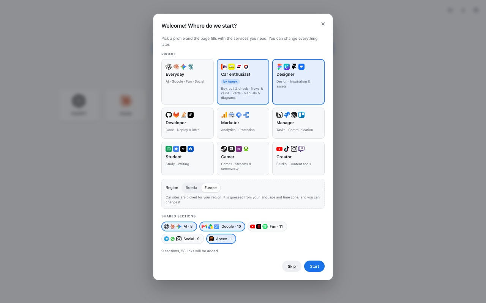
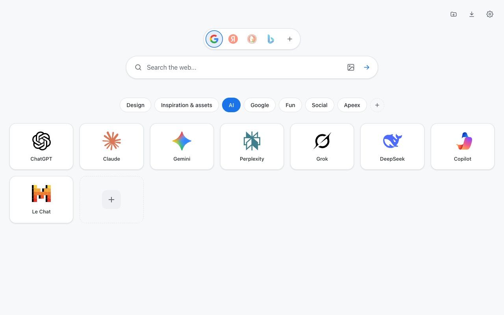
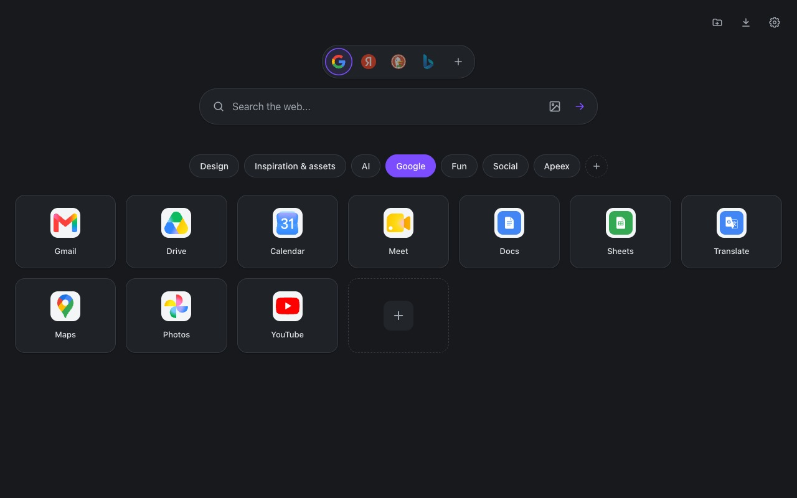
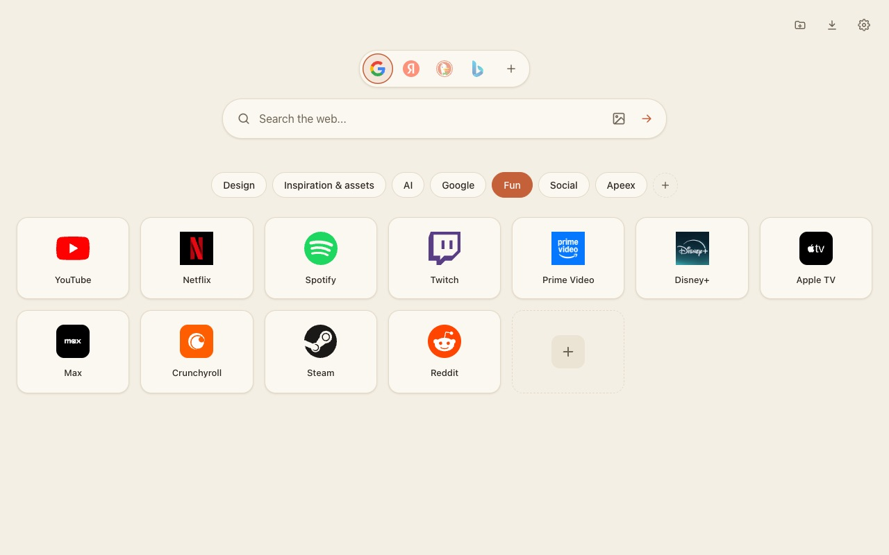
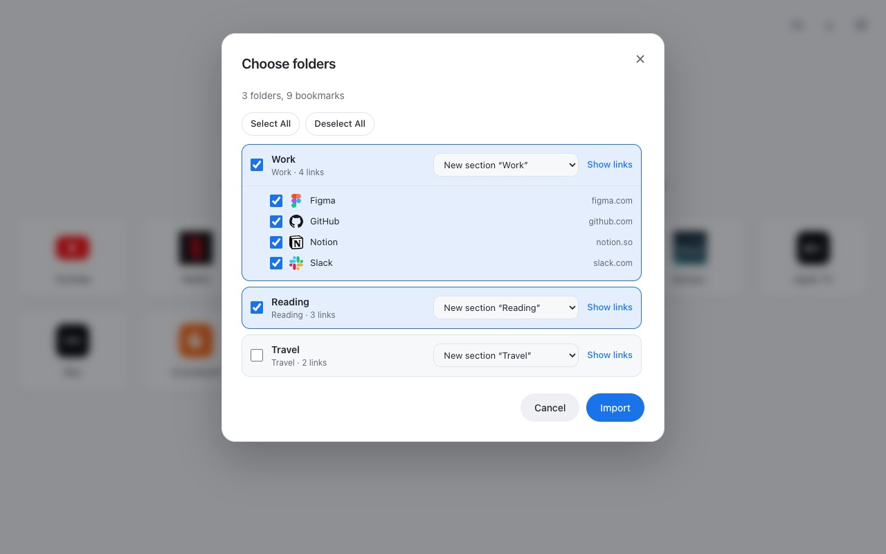

# Apeex Tools

> The desk of your browser by [Apeex](https://apeex.io): everything you work with laid out within reach, so a new tab never opens on an empty page.

A Chrome extension (Manifest V3) that replaces the new tab page with visual bookmarks grouped into sections.



<p>
  
  
  
  
</p>

## Install

The Chrome Web Store listing is on its way. Until then, load it from source:

1. Download or clone this repository.
2. Open `chrome://extensions` and switch on **Developer mode**.
3. Click **Load unpacked** and pick the repository folder.
4. Open a new tab.

No build step and no dependencies: the extension is plain HTML, CSS and JavaScript.

## Features

- Unlimited links and sections, stored in `chrome.storage.local` with `unlimitedStorage`
- Ready-made link sets: 9 profiles (everyday, car enthusiast, designer, developer, marketer, manager, student, gamer, creator) plus shared packs (AI, Google, Fun, Social, Apeex); offered on first run and in Settings
- The car-enthusiast set has separate lists for Russia and Europe, picked from the browser's time zone and language (computed locally, nothing is sent) and switchable in the picker
- Bundled icons for 200+ popular services (`icons/brands/`), sharp favicons for everything else, and custom icons per link
- Search engine bar: built-in engines can be removed, 22 popular presets, or your own engine via a `{query}` URL template
- Themes: auto / light / sand / dark / black, 9 accent colors, 3 tile sizes
- Import: Chrome bookmark folders → sections (pick the folders and links), open tabs, a bookmarks `.html` file from any browser, a `.json` backup
- Backup and restore (replace or merge) of links, sections, engines and settings
- Drag and drop for tiles and sections; drop a tile on a section tab to move it

## User guide

| Task | How |
|---|---|
| Start from a ready-made set | First run shows the picker; later: Settings → **Ready-made link sets** (or the folder icon). Pick one or more profiles and shared sections; duplicates are skipped |
| Add a link | The dashed **+** tile at the end of the grid. Paste a URL: the name fills in by itself (the service's real name for 200+ known services, otherwise a tidy name from the domain) and the icon preview updates. Type your own name and it is never overwritten |
| Change an icon | Edit a link → **Icon**: paste an image URL or **Upload** a file. **Reset** goes back to the automatic icon |
| Add a section | The **+** next to the section pills |
| Rename or delete a section | Hover a pill and use the pencil or the cross. Links from a deleted section move to `other` |
| Reorder | Drag tiles inside the grid; drag section pills along the row |
| Move a link to another section | Drag the tile onto that section's pill |
| Add a search engine | The **+** in the engine bar → click a preset or fill in the name and URL with `{query}` |
| Remove a search engine | Hover it → **×** (built-in ones can be added back from the presets) |
| Import bookmarks | Folder icon top right → **Chrome bookmark folders**. Each folder can go to a new section or into an existing one; **Show links** lets you untick single links |
| Move from another browser | Export bookmarks there as HTML, then folder icon → **Load from file** |
| Back up | Download icon top right (or Settings → Data). The file holds everything |
| Restore | Folder icon → **Load from file** → pick a `.json` backup → **Add to current** or **Replace everything** |
| Theme, colors, tile size, new tab, language | Gear icon top right |

## Project layout

```
manifest.json        MV3 manifest, name/description come from _locales
index.html           page markup
styles.css           theme tokens and all styles
theme-boot.js        applies the saved theme before first paint
brand-icons.js       generated: domain → bundled icon map + findBrandIcon()
script.js            core: storage, links, sections, search, drag and drop
features.js          settings/themes, search presets, imports, backups, custom icons
presets.js           link sets: sections, profiles, the picker and first-run welcome
icons/brands/        bundled service icons (generated)
icons/engines/       search engine icons
_locales/            store name and description (en, ru)
tools/               build scripts, not shipped
docs/                privacy policy and store listing texts
```

## Development

Load the folder unpacked: `chrome://extensions` → Developer mode → **Load unpacked** → this folder. After edits, press reload on the extension card and open a new tab.

The page also runs as a plain web page (any static server). Outside the extension it falls back to `localStorage`, and imports from Chrome are disabled.

### Adding a service icon

1. Add a line to `BRANDS` in `tools/build-brand-icons.py`: key, source (`gb:<file>` from [gilbarbara/logos](https://github.com/gilbarbara/logos) or `si:<slug>` from [Simple Icons](https://simpleicons.org)) and its domains.
2. `npm i simple-icons` somewhere, then `python3 tools/build-brand-icons.py path/to/node_modules/simple-icons`.

Both icon sets are CC0-1.0. Brand logos are trademarks of their owners and are used only to label links to those services.

### Release

1. Bump `version` in `manifest.json`.
2. `./tools/package.sh` → `dist/apeex-tools-<version>.zip` (runtime files only).
3. Upload in the Chrome Web Store dashboard. Step-by-step publishing (account, payment, upload, review, updates) is in [docs/PUBLISH_GUIDE.md](docs/PUBLISH_GUIDE.md); listing texts, permission justifications and the screenshot checklist are in [docs/STORE_LISTING.md](docs/STORE_LISTING.md); the privacy policy is [docs/PRIVACY.md](docs/PRIVACY.md).

## Data and storage

- To change the sets, edit `LINK_SECTIONS` and `LINK_PROFILES` in `presets.js`. A section can have `links` (for everyone) and `regions: { ru: [...], eu: [...] }`. The shared `apeex` section is ticked by default in the picker. When the Apeex Drive page exists, set `APEEX_DRIVE_URL` at the top of `presets.js`: its section then appears in the car set on its own. A link may carry a third value `'ru'` to show only in Russian-like UI languages.
- Storage keys: `links`, `categoryOrder`, `lastCategory`, `customSearchEngines`, `hiddenSearchEngines`, `searchEngine`, `appSettings`, `language`, `onboarded` (first-run picker shown).
- Version 1.0 kept data in `chrome.storage.sync`, which caps each key at 8 KB, so links stopped saving once there were enough of them. On first run, 1.1 copies everything from sync to local once (`storageMigratedToLocal` flag). The sync copy is left in place as a fallback.
- Backup format v2: `{ app, version: 2, exportedAt, links, categoryOrder, customSearchEngines, hiddenSearchEngines, searchEngine, appSettings, language }`. The old format (a bare array of links) still imports.

## Privacy

Everything stays in your browser. No analytics, no accounts, no servers. Details: [docs/PRIVACY.md](docs/PRIVACY.md).

## License

Source code: [MIT](LICENSE). The Apeex name and logo and third-party logos are not covered by it, see [NOTICE.md](NOTICE.md).
